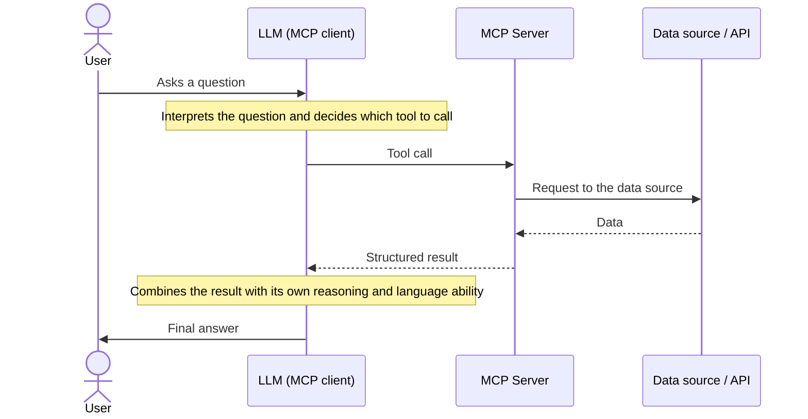

[Home](../../README.md) · [Overview](README.md) · [Explainer](EXPLAINER.md) · [Getting Started](GETTING-STARTED.md) · [Tools](TOOLS.md) · [Use Cases](USE-CASES.md)

# MCP vs LLM: Understanding the Difference

**What an MCP server is, what an LLM is, and why an MCP server does not answer questions on its own**

> [!NOTE]
> **In one line.** An MCP server is not an AI assistant, and it does not "understand" or answer user questions by itself. It is a **connector layer** that gives an LLM structured, reliable access to external data and services. The LLM, not the MCP server, interprets the user's question and writes the final answer.

## What Is an LLM?

An LLM (large language model) is the AI that understands language. It reads the user's question, reasons about what is being asked, decides what to do and writes the reply in natural language. On its own, though, an LLM only knows what it learned in training. It cannot look up live data or call an external service unless it is given a way to.

## What Is MCP?

MCP (**Model Context Protocol**) is an open standard that defines how an LLM-powered application can connect to external tools and data sources in a consistent, structured way. It solves a common integration problem: every AI application that wanted to use an external API used to need a custom, one-off integration. MCP replaces those one-off integrations with a single, standard protocol.

MCP itself carries **no intelligence**. It is a protocol and a transport mechanism: a well-defined way for a client to ask "what tools do you have?" and "please run this tool with these inputs", and for the server to reply with structured results.

## MCP Client and MCP Server

Two roles matter in any MCP setup:

| Role | What it is | What it does |
|---|---|---|
| **MCP Client** | The AI application itself: a chatbot, an IDE assistant, an autonomous agent. It is powered by an LLM. | Understands the user's language, reasons about what to do, decides which tool to call, and writes the final answer. |
| **MCP Server** | A lightweight server that exposes a defined set of "tools" (functions), each with a description of what it does and what input it needs. | Runs a tool when the client asks, and replies with structured results. |

The Mappls MCP Server is an MCP server. It exposes Mappls' location data and services (places, routes, trip estimates and more) as tools that a connected LLM can call.

## MCP vs LLM at a Glance

| | LLM (in the MCP client) | MCP server |
|---|---|---|
| **Understands the user's question** | Yes | No |
| **Decides which tool to call, and with what input** | Yes | No |
| **Holds the conversation** | Yes, through the client application | No |
| **Fetches live data from a service** | No, not on its own | Yes, when a tool is called |
| **Returns structured, accurate data** | No | Yes |
| **Writes the final reply in the user's language** | Yes | No |
| **Is intelligent** | Yes | No, it is a connector |

## How a Query Flows Through the System

This is what happens, end to end, when a user asks an LLM-powered application that has an MCP server connected something the server can help with.

The MCP server is responsible only for the middle steps: receiving a well-formed tool call and returning well-formed data. Everything involving understanding the user, deciding what to do and writing the reply belongs to the LLM.

## A Simple Example

Take a user who asks a location question: *"Where is the nearest petrol pump?"*

| # | Who | What happens |
|---|---|---|
| 1 | **User** | Asks: "Where is the nearest petrol pump?" |
| 2 | **LLM** | Recognises that this needs live location data, and decides to call a tool of the connected Mappls MCP Server. |
| 3 | **MCP server** | Runs the request against Mappls' location services and returns structured data: place names, addresses and distances. |
| 4 | **LLM** | Reads the data, picks the nearest result, and writes the reply in the user's own words. |

Notice what each side did. The MCP server supplied accurate location data. The LLM decided to ask for it, chose what to mention, and wrote the sentence the user read.

## What an MCP Server Is Not

| It is not... | Because... |
|---|---|
| **An LLM** | It has no language understanding, reasoning or generation of its own. It cannot interpret an ambiguous question or hold a conversation. |
| **A general question-answering system** | It only responds to the tools it exposes. If a user asks something unrelated, the server is never called. |
| **The author of the final answer** | It returns data. Turning that data into a helpful reply is the LLM's job. |
| **A replacement for the conversation** | The conversation lives in the LLM and the application around it. |
| **A guarantee of a correct final answer** | Output quality still depends on the LLM choosing the right tool, with the right inputs, at the right time. The server guarantees only that, if it is called correctly, it returns accurate data. |

## A Simple Analogy

Think of an MCP server as a **multilingual waiter in a restaurant**. It is not the chef, and not the customer.

The customer (the user) tells the waiter's colleague, the LLM, what they want, in plain conversation. The LLM decides what to order and asks the waiter (the MCP server) to place a specific, well-defined order with the kitchen (the data source). The waiter does not decide the menu, does not cook the food and does not make small talk with the customer. It makes sure the right order reaches the kitchen and the right dish comes back. The LLM then serves it to the customer, explained in their own words.

## Why This Distinction Matters

When evaluating or demoing an MCP server, it helps to keep expectations aligned to what is actually being tested:

- If a response feels incomplete or oddly phrased, the issue may be in how the connected LLM is using the data, not in the MCP server or the data behind it.
- An MCP server is only as useful as the tools it exposes and the accuracy of the data those tools return. It is not meant to be evaluated as a standalone chatbot.
- Adding new tools or richer data to an MCP server directly expands what any connected LLM can offer users.

**When an answer looks wrong, check in this order**

| Check | If the answer is... | Then the cause is most likely... |
|---|---|---|
| 1. The data the tool returned | Wrong or missing | The data source or the server. |
| 2. The data the tool returned | Right, but the final wording or reasoning is off | The connected LLM's behaviour. |
| 3. Which tool the LLM called | The wrong tool, or the wrong input | The LLM's choice of tool. |

## Common Questions

**Won't an MCP server just answer anything a user asks?**
No. The server only responds to the specific tools it exposes. Anything outside that scope is handled by the LLM itself, or the LLM says it cannot help. The server is never called.

**Can an MCP server work on its own, without an LLM?**
No. On its own it just waits for a tool call. It has no way to receive a plain-language question or produce a plain-language answer. It needs an LLM, or another MCP client, driving it.

**If a demo answer is wrong or oddly worded, is that an MCP bug?**
Usually not. Check whether the data returned by the tool was correct first. If the data was right but the final wording or reasoning was off, that is the connected LLM's behaviour, not the server's.

**Does adding more tools make the server "smarter"?**
Not smarter, but more capable. It widens what data an LLM can draw on when answering. The reasoning and language quality still come entirely from the LLM.

## Bottom Line

> An MCP server does not answer questions. It gives an LLM structured, reliable access to data and services, so the LLM can answer questions better.

## Where to Go Next

- [Overview](README.md): what the Mappls MCP Server offers.
- [Getting Started](GETTING-STARTED.md): connect a client to the server.

---

For any queries and support, please contact:

Need support? [Contact us](https://about.mappls.com/contact/)

© Copyright 2026 CE Info Systems Ltd. All Rights Reserved.

  <a href="https://about.mappls.com/api/terms-&-conditions">Terms & Conditions</a> |
  <a href="https://about.mappls.com/about/privacy-policy">Privacy Policy</a>

